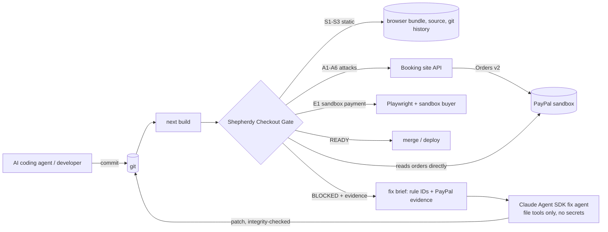

# Shepherdy Checkout Gate

**A release gate for AI-written PayPal checkouts.** It attacks your checkout in the PayPal sandbox and says
`READY` only when PayPal's own records agree. When it says `BLOCKED`, a fix agent reads the evidence, patches the
code, and the gate runs again.

> The agent fixes. PayPal proves. The gate decides.

AI coding tools can add "Pay with PayPal" in minutes. The happy path works, the demo passes, and the site ships
with a checkout where the browser chooses the price, the secret key sits in the JavaScript bundle, or a booking is
confirmed for an order nobody paid. Scanners read code and guess. This gate asks PayPal.

 

---

## Who it is for, and why it matters

- **Founders and small teams building with AI coding tools.** They can get a PayPal button working in minutes but
  cannot review payment code. The gate checks the parts that lose money.
- **Agencies and freelancers shipping AI-built sites.** A READY report on the exact commit is proof for the client
  that the checkout was attacked and held before handover.
- **PayPal's developer ecosystem.** Fewer broken integrations reach production, and failure paths that are hard to
  reproduce in the sandbox get tested on every change.

The problem is not hypothetical:

- About 1 in 5 of ~130,000 sites published from vibe-coding platforms leaked at least one secret
  ([RedHunt Labs](https://redhuntlabs.com/blog/echoes-of-ai-exposure-thousands-of-secrets-leaking-through-vibe-coded-sites-wave-15-project-resonance/)).
- An AI tool put a payment secret key in client-side JavaScript; an attacker charged 175 stored customers $500 each
  ([Towards AI](https://pub.towardsai.net/vibe-coding-didnt-break-these-startups-vibe-deploying-did-3bdd8d0428c4)).
- AI-generated code shipped without sandbox testing broke a working payment system for about a month
  ([GetDevDone](https://getdevdone.com/blog/the-vibe-coding-tax-a-payment-integration-broken-by-ai-restored-by-engineering.html)).
- An agent can make a payment flow run end to end, but cannot know the business rules the money must obey unless
  someone tells it ([Stripe developer blog](https://stripe.dev/blog/helping-ai-built-payment-integration-understand-business-intent)).
- PayPal's own engineers describe developers and merchants dropping off during sandbox integration flows
  ([PayPal Tech](https://medium.com/paypal-tech/how-paypal-is-solving-merchant-dropout-issues-with-sandbox-integrations-bbde98f588fc)).

## The product, end to end

1. **Playbook** for any coding agent (`playbook/paypal-checkout.md`, rules PP-00…PP-09).
2. **Gate** you run locally or before a deploy: `npm run gate` (14 checks, exit 0/1/2).
3. **CI**: `.github/workflows/checkout-gate.yml` runs the static checks on every pull request and blocks the merge.
4. **Fix loop**: `npm run loop` turns a BLOCKED report into a patch from the fix agent, then gates again.
5. **Release report on the site**: `npm run gate:publish` publishes the latest real run to `/gate`, and every page
   shows a "Checkout verified" badge that links to it.

## What it does

The repo contains two things:

1. **Lumen Trails**, a small Next.js booking site (an "AI-built app") with a PayPal one-time payment.
2. **The gate** (`gate/`), the **playbook** (`playbook/`) and the **fix loop** (`agent/`).

The gate runs 14 checks and turns them into one verdict with plain rule code:

| Check | Rule | What the gate actually does |
|---|---|---|
| D1–D4 | PP-08 | Credentials present, sandbox only (refuses live PayPal), PayPal answering, app up. Setup problems give `INCONCLUSIVE`, never a false `READY` or `BLOCKED`. |
| S1 | PP-06 | Searches the **built browser files** (`.next/static`, prerendered HTML/RSC) for the secret's exact value. |
| S2 | PP-06 | `NEXT_PUBLIC_*SECRET*`, secrets in `next.config` `env`, client components touching the secret, server modules without `import "server-only"`. |
| S3 | PP-07 | Committed `.env` files, the secret value anywhere in git history, and a **rotation lock**: a leaked secret keeps blocking until its value changes. |
| A1 | PP-01 | Sends `amount: 0.01` for a $120 booking, then **asks PayPal** what the order amount is. |
| A2 | PP-02 | Captures an order nobody approved. |
| A3 | PP-02 | Captures a made-up order ID. |
| E1 | PP-04 | A real sandbox buyer pays (Playwright, or `--manual` approval in the popup). PayPal's record must say `COMPLETED` at the server price, and only then may the booking be `paid`. |
| A4 | PP-02 | During E1, intercepts the page's capture request and first tries to attach the approved order to **another** booking. |
| A6 | PP-05 | During E1, makes PayPal decline the payment with sandbox negative testing (`PayPal-Mock-Response: INSTRUMENT_DECLINED`). The booking must stay unpaid and the buyer must be able to retry. |
| A5 | PP-03 | After E1, sends the capture again. PayPal must still hold exactly one capture. |

`BLOCKED` exits 1, `INCONCLUSIVE` exits 2, `READY` exits 0, so it can sit in front of any merge or deploy.
Every run writes `.gate/report.html`: each check with its evidence next to what PayPal recorded, PayPal-Debug-Ids
for support tickets, and a run history (`BLOCKED → agent fix → READY`).

## How PayPal is used

- **Orders v2 REST API** with OAuth client credentials, server-side only (`lib/paypal.ts`, `import "server-only"`).
- `POST /api/paypal/create-order {bookingId} → {orderId}`: the amount comes from the booking record; whatever the
  browser sends is ignored; `reference_id = bookingId` ties the order to one booking.
- `POST /api/paypal/capture-order {orderId, bookingId}`: GET the order (reference_id, amount, `APPROVED`) →
  capture with a fixed `PayPal-Request-Id` (retries never double-charge) → GET again → `paid` only on
  `COMPLETED` with the right amount; `PENDING` stays unconfirmed; `INSTRUMENT_DECLINED` returns 402 + retry.
- `GET /api/paypal/booking-status?bookingId=` for the gate.
- **JS SDK v6** through `@paypal/react-paypal-js/sdk-v6`: `PayPalProvider` + `PayPalOneTimePaymentButton`,
  `environment="sandbox"`. The public client ID is passed from a server component; the secret never leaves the server.
- **The gate talks to PayPal itself** with its own read-only client, so it never trusts the app's word.
- **Sandbox negative testing** (`PayPal-Mock-Response`) to prove failure handling, which developers often cannot
  reproduce in the sandbox.
- USD, because PayPal does not support KRW.

## How AI is used

- **The integration itself was written by an AI coding agent** (Claude, via Claude Code) following
  `playbook/paypal-checkout.md`, and then had to pass the gate like any other commit.
- **The fix agent** (`agent/fixer.mjs`) is built on the **Claude Agent SDK** (`claude-sonnet-5-5` by default).
  It gets a brief made from the gate report (check IDs, playbook rule IDs, PayPal evidence) and may only use
  file tools (`Read`, `Glob`, `Grep`, `Edit`, `Write`); no shell, no web.
- **The agent never sees secrets.** It works in a throwaway copy of `app/`, `components/`, `lib/` and
  `next.config.ts` with no `.env` files and an environment without PayPal keys. Reports and briefs are masked.
- **The agent cannot grade itself.** Verdicts come from rule code only. The gate and playbook run from a copy
  taken before the agent starts; if the agent changes them, the files are restored and the round is `BLOCKED`.
- Any other agent can plug in with `AGENT_CMD` (it receives the brief path in `$FIX_BRIEF`).
- `LLM_MODE=fake` restores the last `READY` version of the flagged files without AI, for offline tests and demos.

## Architecture



```
app/                     booking site (Next.js App Router) and API routes
components/              PayPalCheckout (sdk-v6 button), BookForm
lib/                     paypal.ts (server-only REST client), store.ts (file or Postgres), catalog.ts (prices)
gate/run.mjs             the gate CLI; gate/lib/* checks, verdict, HTML report
agent/loop.mjs           build → start → gate → fix → integrity check → commit → gate again
playbook/                PayPal rules (PP-00…PP-09) for coding agents; rules.json feeds the fix brief
demo/risky-checkout.patch  the risky commit used in the demo video
tests/                   offline tests (npm test)
```

## Run it

Requirements: Node 20.9+, a free PayPal Developer account, Chrome-compatible browser for Playwright.

```bash
git clone https://github.com/<you>/shepherdy-checkout-gate && cd shepherdy-checkout-gate
npm install
npx playwright install chromium
cp .env.example .env.local
# fill PAYPAL_CLIENT_ID / PAYPAL_CLIENT_SECRET (Sandbox app), PAYPAL_SANDBOX_BUYER_EMAIL / _PASSWORD
# (Sandbox personal account), GATE_MOCK_TOKEN (any long random string)
npm test                 # offline tests, no network
npm run build && npm run start   # booking site on http://127.0.0.1:3000
npm run gate             # in another terminal; add `-- --manual` to approve the sandbox payment yourself
open .gate/report.html
npm run gate:publish     # copy the latest real run to public/release/ so /gate shows it (secrets masked)
```

### The demo: risky commit → BLOCKED → agent fix → READY

```bash
npm run gate -- --manual          # on main: READY (records the last READY commit)
git switch -c demo/risky-checkout
git apply demo/risky-checkout.patch
git commit -am "feat: faster checkout (send price from the button, debug PayPal key)"
npm run loop -- --manual          # round 1 BLOCKED (S1, S2, A1) → fix agent → round 2 READY
```

Use `LLM_MODE=fake npm run loop -- --manual` to run the same loop without an Anthropic API key.

## For judges

- **Live site:** see "Testing instructions" in the Devpost submission for the URL and a **PayPal sandbox buyer
  account** (fake money). Book any experience and pay with that account.
- **Release report:** open `/gate` on the live site to see the latest real gate run: every check, what PayPal
  recorded, and the BLOCKED → agent fix → READY history. No setup needed.
- **Run the gate yourself:** follow *Run it* with your own PayPal sandbox app (Developer Dashboard → Apps &
  Credentials → Sandbox → Create App; Testing Tools → Sandbox Accounts for the buyer).
- Judges do not need an Anthropic key: `LLM_MODE=fake` exercises the full loop.

## Deploy (Vercel)

Serverless hosts do not keep local files, so set `DATABASE_URL` to any Postgres (Neon, Supabase pooler, …);
the `bookings` table is created on first use. Environment variables: `PAYPAL_CLIENT_ID`, `PAYPAL_CLIENT_SECRET`,
`PAYPAL_API_BASE=https://api-m.sandbox.paypal.com`, `DATABASE_URL`, and optionally `GATE_MOCK_TOKEN` to run the
gate against the deployment: `npm run gate -- --base-url https://<your-app>.vercel.app --manual`.

## Related work

| Tool | What it covers | What this adds |
|---|---|---|
| Gitleaks, TruffleHog | secrets in git | the secret in the **built bundle**, plus a rotation lock |
| @snytch/nextjs | Next.js bundle and `NEXT_PUBLIC_` scanning | PayPal-specific attacks verified against PayPal records |
| Vibe-coding scanners (vibe-shield, Vibeship, …) | static scans + AI fix prompts | fix prompts grounded in PayPal's actual responses; deterministic verdicts the agent cannot edit |
| PayPal Agent Toolkit / MCP server | agents **running** PayPal operations | verifying the checkout an agent **wrote** |
| PayPal Context Plugin, PayPal agent skills | helping agents **write** correct SDK calls | proving the result before release; works with them |

## Built during the submission period

Everything in this repository was written on Nov 12–13, 2026, inside the hackathon window. It is a new, open
module derived from **Shepherdy**, our private launch-agent prototype, which itself was started on Nov 4, 2026
(24 commits, Nov 4–10). The private prototype covers other integrations and services and is not part of this
submission; nothing here depends on it. See `git log` for the day-by-day history of this repository.

## License

[MIT](LICENSE)
